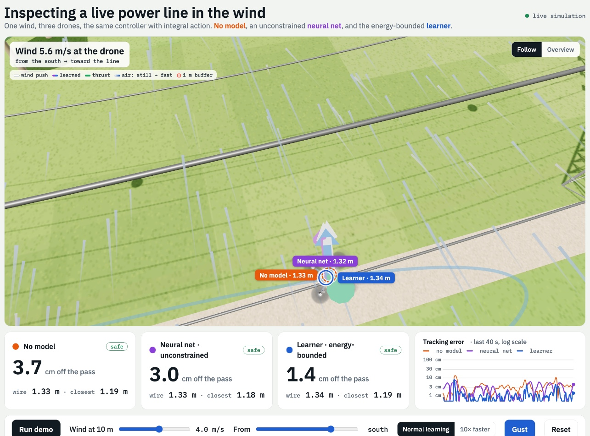

# Falcon

**An autonomous flight-test engineer for inspection drones. It clears a drone to fly, sets its
limits, or grounds it.**

Give Falcon a one-line brief and a Claude agent runs the whole flight-test campaign on its own:
forecast, test flights, prediction and report. Work that takes a flight-test engineer days finishes
in under 8 minutes, and every number in the report is checked against the flight log.

Built at the Imperial AI Hackathon 2026 for the Autonomous Agents track.



## A recorded mission

> Clear the drone for tomorrow's power-line inspection pass at 20 m near South Kensington, London.

The forecast came back at 4.7 m/s with 10.7 m/s gusts. Falcon flew 35 test runs, fitted a drag law
and predicted the envelope edge at 7.3 m/s. Testing in turbulence put the real edge between 4 and
5 m/s. It filed:

> **Decision: NO-GO for tomorrow as forecast. GO WITH LIMITS only if on-site wind measures inside
> the limits below.**
>
> - Mean wind ≤ 2 m/s at 10 m, any direction.
> - Controller ph only, learning rate 0.05.
>
> | Case | rms | max |
> |---|---|---|
> | 2 m/s −x (worst), ph | 0.9 cm [rf8524b.rmse_m] | 4.3 cm [rf8524b.max_err_m] |
> | 5 m/s +y, ph | 18.2 cm [r45017e.rmse_m] | 43.8 cm [r45017e.max_err_m] |

Each figure carries the ID of the run it came from, and `ph` is Falcon's learner. The full mission
is in [docs/missions/sample.jsonl](docs/missions/sample.jsonl) and replays in the demo.

## The problem

Drones inspect power lines a metre or two from the wire, in gusts that arrive unannounced.
Someone has to decide whether a drone is safe to fly and under what limits, and today that takes a
flight-test engineer days. An AI agent earns that job only if it follows every safety step and
reports only numbers it measured.

## How it works

1. **Forecast:** looks up the site's wind through Linkup and cites the source.
2. **Identify:** holds position at 20 m and measures drag and torque from the vehicle's own sensors.
3. **Predict:** writes and runs code to fit a drag law and predict the envelope edge.
4. **Expand:** flies the inspection pass with three controllers in turbulence and gust fronts,
   stepping up in wind.
5. **Reconcile:** explains where the prediction missed, using physics it measured.
6. **Report and show:** files the decision with operating limits, then flies that limit live.

These checks are enforced in code, not in the prompt:

- **Build-up rule.** The tools refuse any step more than 2 m/s past the last wind cleared, and
  anything at or above a wind that crashed.
- **Report checker.** Every number must cite a run, like `2.1 cm [r8b3739.rmse_m]`. Misquoted or
  uncited numbers are rejected until the agent fixes them.
- **One wind field** for batch tests and the live demo.
- **A learner that can't add energy.** The drone's learned force, `F = -D (v - ŵ)` with
  `0 < D < d_max`, only removes energy, for any weights.

The full physics write-up is in [docs/physics.md](docs/physics.md).

## Results

Inspection pass at 20 m: wind given at 10 m, surface-layer turbulence and a 2 m/s gust front.
Tracking error in cm over 10 seeds.

| | No model | Neural net | Learner |
|---|---:|---:|---:|
| 3 m/s | 3.2 ± 0.2 | 2.8 ± 0.3 | **1.0 ± 0.1** |
| 4 m/s | 4.5 ± 1.1 | 3.8 ± 0.9 | **2.1 ± 1.1** |
| 4 m/s, learning 10× faster | **4.5 ± 1.1** | 30.5 ± 8.2 | 7.6 ± 2.7 |

The learner is 2 to 3× tighter than no model. A typical mission clears 3.5 m/s, below an edge
between 4 and 5 m/s.

## Quick start

```bash
git clone https://github.com/Adeniyikayodee/imperial_falcon_hack.git && cd imperial_falcon_hack
uv sync --extra agent
cp .env.example .env                              # add ANTHROPIC_API_KEY; Linkup and Databricks are optional
uv run --extra agent python scripts/live.py       # open http://localhost:8765
```

- **Clear for flight** runs a mission, which takes about 10 minutes.
- **Replay** plays a recorded mission at 20× speed, with no API needed.
- **Run demo** plays scripted gusts.

To run a mission from the terminal:

```bash
uv run --extra agent python -m agent.run --mission "Clear the drone for tomorrow's pass near South Kensington."
```

To run the tests: `uv run --extra agent pytest` (57 tests).

## APIs, models and datasets

- **Models:**
  - Claude Fable 5.2 through the Anthropic API, using the tool runner and code execution. Claude
    Opus 5.5 is optional.
  - The drone's learned models are mine and are trained online in every flight. No pretrained
    weights.
- **APIs:** Anthropic, the Linkup Search API, and Databricks MLflow.
- **Datasets:** none. All flight data comes from my simulator.
- **Libraries:** JAX, NumPy, the anthropic SDK, MLflow, three.js (r128) and pytest.

## Project structure

```
falcon/   simulator, controller, wind, learned models, experiments
agent/    mission, tools, build-up rule, report checker
scripts/  demo server with recording and replay, envelope sweep
web/      3D demo page
docs/     physics, presentation script, sample mission
```
